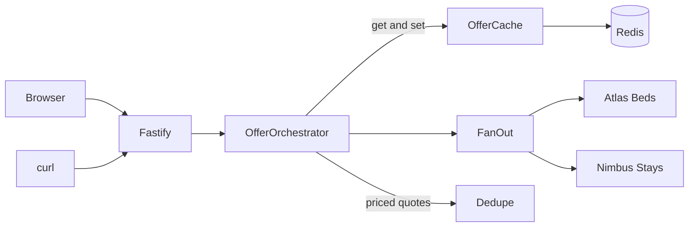

# Offer Desk

Offer Desk is a hotel offer orchestrator: one Node.js / TypeScript (ESM) Fastify process. It asks two providers for quotes, prices every stay with the same occupancy rule, merges quotes for the same hotel, keeps the cheaper stay, and stores that merged document in Redis.

The process listens on port 4781. Redis defaults to `redis://127.0.0.1:6379`. Full results live for 900 seconds plus up to 30 seconds of jitter. A partial provider failure lives for 30 seconds. A total provider failure is not stored. Redis is the only network dependency. Both providers run in-process. Callers are not authenticated.

These notes are the contract the code implements.

## Components



The browser and curl hit Fastify. Fastify validates the query and calls `OfferOrchestrator`. The orchestrator reads and writes through `OfferCache`, and `OfferCache` talks to Redis.

On a miss, a Redis failure, or a corrupt document, the orchestrator calls `FanOut`. Fan-out calls Atlas Beds (`atlas`) and Nimbus Stays (`nimbus`) in parallel. Each adapter implements `HotelProvider`. The default adapters are in-process mocks: a function call, a latency timer, and a per-provider timeout (default 800ms). They are not HTTP calls back into this process. A real supplier adapter implements the same interface and replaces a mock without a change to pricing, dedupe, or the cache key.

The orchestrator prices the quotes, then passes them to dedupe. Dedupe groups them by hotel identity and picks a winner.

## Modules

```
src/server.ts
src/config.ts
src/logger.ts
src/http/app.ts
src/search/query.ts
src/search/payload.ts
src/search/orchestrator.ts
src/domain/dedupe.ts
src/domain/identity.ts
src/domain/pricing.ts
src/domain/types.ts
src/domain/errors.ts
src/catalog/hotels.ts
src/providers/hotel-provider.ts
src/providers/mock-provider.ts
src/providers/fan-out.ts
src/cache/offer-cache.ts
src/cache/memory-cache.ts
src/cache/redis-cache.ts
public/
```

`server.ts` loads config, builds the app, listens, and on `SIGINT` or `SIGTERM` closes Fastify and then the Redis client. `config.ts` reads the environment and refuses to boot on a bad value. `logger.ts` is the pino logger. The Redis warning fields are fixed there.

`http/app.ts` builds Fastify, registers the routes, serves `public/` at `/`, and turns thrown errors into the error body. The error handler logs the stack and sends a fixed message.

`search/query.ts` parses the query, fills defaults, and canonicalizes the city. `search/payload.ts` writes the JSON body and the response headers from one result object. `search/orchestrator.ts` owns the cache read, singleflight, fan-out, write policy, and per-request filter.

`domain/pricing.ts` applies occupancy. `domain/identity.ts` applies the alias tables and builds `hotelId`. `domain/dedupe.ts` groups quotes and picks the winner. `domain/types.ts` holds the shared types. `domain/errors.ts` defines `INVALID_QUERY`, `NOT_FOUND`, `PROVIDERS_UNAVAILABLE`, and `INTERNAL`.

`catalog/hotels.ts` is the fixed mock list. Both adapters read it. Rates do not vary by date. The date still enters the cache key so two stays cannot collide, and so a later supplier adapter can return different prices for different dates without a key change.

`providers/hotel-provider.ts` is the interface. `mock-provider.ts` is Atlas Beds and Nimbus Stays. `fan-out.ts` runs them in parallel and enforces the timeout. `failProvider` is applied here as an immediate failure of that provider, before its latency timer starts.

`cache/offer-cache.ts` is the port the orchestrator calls: get, set, TTL choice, and corrupt detection. `redis-cache.ts` is the production adapter. `memory-cache.ts` is the same get/set port backed by a `Map`, including per-key expiry. Unit tests construct the memory adapter directly. Production wires Redis. A failed Redis command ends the cache attempt for that request.

`public/` is the Offer Desk UI, static files with no build step. `public/index.html` is `GET /`.

## Request path

1. `query.ts` validates the query. A failure returns 400 and stops. Defaults and the city alias run only after validation.
2. The orchestrator builds `offers:v1:{city}:{checkIn}:{checkOut}:{guests}:inr`.
3. A request with `failProvider` skips Redis and skips singleflight. It fans out on its own.
4. Otherwise the orchestrator enters singleflight, and the leader calls `OfferCache`.
5. A valid document is filtered and sorted in the request and returned as `HIT`. Providers are not called.
6. A miss, a corrupt document, or a Redis error fans out. `pricing.ts` runs on every returned quote. `dedupe.ts` merges them.
7. The leader writes Redis only when the write rules below allow it.
8. `payload.ts` copies cache status, reason, key, and age into both the headers and `meta.cache`.

Price filters and the result sort run per request, after the shared document exists. Joiners on one flight can carry different `minPrice`, `maxPrice`, and `sort`. Those values are not in the key, and they do not split the flight.

## Decisions

### 1. Fail-open cache

If Redis cannot be reached, the search still returns offers. The response carries `X-Cache: BYPASS` and `X-Cache-Reason: redis_unreachable`. The process logs a warning. The warning includes the host, the port, and the error code (`ECONNREFUSED` when nothing is listening). Operators then check that port. The log line is specified in `OPERATIONS.md`.

The user request does not wait on Redis retries. The client disables the offline queue, so a command issued while Redis is down fails immediately instead of sitting in a buffer. Connect timeout and command timeout are each 300ms. Those timeouts are constants in `redis-cache.ts`, not environment variables. A dead socket is replaced once. The client may also reconnect in the background for a later request. The failed request does not block on that reconnect.

A `GET` that fails is enough to take the bypass path. The leader then skips `SET`. If `GET` was a miss and the following `SET` fails, the process logs the same warning and still answers `BYPASS`. The offers are the live fan-out. The key remains absent.

The host and port in the log are parsed from `REDIS_URL`. Userinfo from the URL is never logged. When the error carries no code, the field is `UNKNOWN`.

### 2. The cheaper stay wins

The winner is the lower guest total after occupancy pricing. A tie breaks to the higher `guestRating`, then to the provider id in ascending order (`atlas` before `nimbus`). Commission is stored on the quote as `commissionPct` and is not an input to the ranking.

Optimizing commission would pick a worse price for the traveller, which this service refuses to do. In the Oberoi pair from `FLOW.md`, that choice would sell the Atlas stay at ₹18,500 ahead of the Nimbus stay at ₹17,200.

The winner card keeps the losing quotes on `alternatives`, in the same comparator order. `savingsVsNext` is the runner-up total minus the winner total, in rupees. It is `null` when the hotel was quoted once. It is `0` when the totals tie and the rating or the provider id decided the winner. Ratings are not averaged across providers. The card shows the winner's stars and `guestRating`.

### 3. Identity is an alias table plus a slug

A hotel id is a canonical city plus a slugged hotel name: `delhi:the-oberoi`.

Normalization:

1. Trim, then collapse internal whitespace to a single space.
2. Look up the city in the city table, case-insensitive, exact match.
3. Look up the provider's listed hotel name in the hotel table, case-insensitive, exact match.
4. Slug the canonical hotel name: lowercase, replace each run of characters outside `a-z` and `0-9` with one hyphen, strip hyphens at the ends.
5. Slug the canonical city by lowercasing it and removing spaces. `New Delhi` is already rewritten to `Delhi` before this step, so the key segment is `delhi`.

City aliases:

| Input | Canonical |
| --- | --- |
| Bangalore | Bengaluru |
| Bombay | Mumbai |
| New Delhi | Delhi |

Hotel aliases:

| Listed name | Canonical name |
| --- | --- |
| Oberoi New Delhi | The Oberoi |
| Taj Mahal Hotel New Delhi | Taj Mahal Hotel |
| Taj Mahal Palace Hotel | The Taj Mahal Palace |
| ITC Windsor Bengaluru | ITC Windsor |
| Fort Aguada Beach Resort | Fort Aguada |

`The Oberoi` slugs to `the-oberoi`. `Taj Mahal Hotel` slugs to `taj-mahal-hotel`. `The Taj Mahal Palace` slugs to `the-taj-mahal-palace`. `ITC Windsor` slugs to `itc-windsor`. `Fort Aguada` slugs to `fort-aguada`.

A name that misses the table stays as the normalized spelling. `The Oberoi New Delhi` does not match `Oberoi New Delhi`, so it does not merge with `The Oberoi`. Fuzzy matching is out of scope because a false merge is worse than a duplicate listing.

A quote whose canonical city differs from the query city is dropped before dedupe. The mocks already filter by city. The drop stays in front of a future supplier adapter so a stray city cannot merge into the searched city on a shared name.

### 4. Filters stay off the cache key

`minPrice`, `maxPrice`, and `sort` are applied after the cache read, in the process, on the merged cards. They are not part of the cache key.

```
offers:v1:{city}:{checkIn}:{checkOut}:{guests}:inr
```

`city` is the canonical city slug. `checkIn` and `checkOut` are `YYYY-MM-DD`. `guests` is the integer guest count. The suffix `inr` is the currency slot. This version prices only INR and accepts no currency parameter.

The bounds are inclusive and apply to the winner's stay total. A card inside the range still carries alternatives whose totals fall outside it. A loser is not promoted into its own card when the winner is filtered out. An empty filter result is HTTP 200 with `offers: []`. The stored document still holds the full merge, so a wider filter on the next request is a hit and returns the cards the first response hid.

`sort` reorders cards after the filter:

| `sort` | Order |
| --- | --- |
| `price` (default) | total ascending, `guestRating` descending, `hotelId` ascending |
| `rating` | `guestRating` descending, total ascending, `hotelId` ascending |
| `stars` | stars descending, total ascending, `guestRating` descending, `hotelId` ascending |

`hotelId` order is lexicographic on the id string. The same document then produces the same order on a hit and on a miss.

### 5. One occupancy rule, applied before compare

The nightly rate covers 1 or 2 guests. Each guest past 2 adds 15% to the nightly rate. The uplifted nightly rate is rounded to the rupee, then multiplied by nights. Both providers are priced with this rule before comparison. A provider quote carries the base nightly rate and does not carry a total. `pricing.ts` is the only place a total is born, so an adapter cannot smuggle a second occupancy rule into the compare.

```
extra = max(0, guests - 2)
nightlyCharged = round(nightlyRate * (1 + 0.15 * extra))
total = nightlyCharged * nights
```

`round` is half away from zero for positive amounts, which is JavaScript `Math.round` on a positive number. Base catalog rates are whole rupees, so 1 or 2 guests need no rounding. The stay total is not rounded a second time. `FLOW.md` runs the rule on The Oberoi, including a 3-guest case where rounding and then multiplying differs from multiplying and then rounding.

### 6. One provider interface, two in-process mocks

```ts
interface HotelProvider {
  readonly id: "atlas" | "nimbus";
  readonly name: string;
  search(input: ProviderSearch): Promise<ProviderQuote[]>;
}
```

`ProviderSearch` carries the canonical city, `checkIn`, `checkOut`, and `guests`. `ProviderQuote` carries `providerId`, `listedName`, `city`, `stars`, `guestRating`, `nightlyRate`, and `currency: "INR"`.

Atlas Beds is registered first, Nimbus Stays second. Header lists and the `providers.ok` / `providers.failed` arrays follow that order. Winner selection uses the price comparator, not registration order.

The mock waits `MOCK_LATENCY_MS` (default 120) and then returns the catalog rows for that city. The base rate does not depend on `guests`. The fan-out races each call against `PROVIDER_TIMEOUT_MS` (default 800). A timeout fails that provider and clears its latency timer. The other provider is left to finish. The fan-out settles when both have succeeded or failed. Wall time is the slower of the two, capped by the timeout.

`failProvider` fails the named provider immediately with log code `INJECTED` and does not start its timer. An organic timeout logs `TIMEOUT`. Any other throw logs `PROVIDER_ERROR`. The log is info, message `provider failed`, fields `provider` and `code`.

### 7. Singleflight is in-process

Concurrent misses for one key share one fan-out. The map lives in the orchestrator: cache key to the leader's promise. It is updated synchronously, before the leader awaits, so two misses cannot both walk past the check and both call the providers. The `finally` block deletes the entry. The map stores no offer bytes after the promise settles. A restart drops it. Keys that Redis still holds are hits on the next request.

The leader's cache status is `MISS` when it completes a fill, or `BYPASS` when Redis cannot be used. Joiners get `COALESCED` and `X-Cache-Reason: joined_inflight`. They reuse the leader's merged document, then apply their own filter and sort. A joiner keeps the leader's HTTP status. On a 200 it filters the shared document for its own query. On a 502 it returns the same error body, with `X-Cache: COALESCED`. If a waiter attached while the leader was still reading and the read returns a valid document, the leader reports `HIT`, the waiter reports `COALESCED`, and neither calls the providers.

This does not coordinate across replicas. A multi-instance lock (`SET NX`) is a follow-up, not something the code pretends to do. Two replicas can both miss and both write. The last writer wins. Both documents are valid merges for the same key. `failProvider` does not join the flight and does not write, so a demo failure cannot land in the key the other replica is filling.

### 8. `failProvider` bypasses the cache

`failProvider` is a fault-injection switch with values `atlas` or `nimbus`. The request does not read Redis and does not write Redis, so a demo failure cannot poison the key. The response is `X-Cache: BYPASS` and `X-Cache-Reason: fault_injection`. There is no Redis warning. The other provider is called normally. If it returns quotes, the HTTP status is 200 and the injected id is listed in `X-Providers-Failed`. If the other provider fails as well, the status is 502 and the key is still untouched.

This path is separate from an organic partial failure. An organic single-provider failure is stored for 30 seconds. An injected failure is not stored at all.

### 9. Corrupt payloads are refreshed

A Redis value is corrupt when it is not JSON, when `version` is not `1`, when a required field is missing, when `offers` is not an array, when `storedAt` is not a parseable time, or when the document's city, dates, guests, or currency disagree with the key. Unknown extra fields are ignored.

A corrupt value is a miss. The leader fans out, and on a successful merge it overwrites the key. The response is `X-Cache: MISS` and `X-Cache-Reason: refreshed_corrupt`. The process logs a warning, message `cache payload corrupt; refreshing`, field `key`. The raw bytes stay out of the log.

If that fan-out fails for both providers, the handler throws before any cache write. The HTTP status is 502 `PROVIDERS_UNAVAILABLE`, and `X-Cache` is not set. The corrupt bytes are left in place. The next request tries the refresh again. `refreshed_corrupt` is reserved for a response that actually overwrote the key.

### 10. Health is fail-open

`GET /health` returns HTTP 200 with `status` `ok` or `degraded`. `ok` means the Redis ping succeeded. `degraded` means it did not, and `redis.ok` is false. The ping uses the same 300ms command timeout. Readiness does not require Redis, because search is designed to run without it. A load balancer that only checks the status code keeps sending traffic while the pill is down.

Health reports the ping result in the body. It does not emit `cache bypassed because redis is unreachable` on every scrape. The search path emits that warning when a user request actually bypasses the cache.

## Cache record

The key is `offers:v1:{city}:{checkIn}:{checkOut}:{guests}:inr`. Example, for the worked Delhi stay:

```
offers:v1:delhi:2026-11-22:2026-11-24:2:inr
```

The value is UTF-8 JSON. `redis-cli GET` can print it. Raw provider payloads are not stored. A shape change bumps the key prefix and `version` together (`offers:v2`, `version: 2`).

```json
{
  "version": 1,
  "storedAt": "2026-11-21T06:40:12.000Z",
  "ttlSeconds": 914,
  "city": "Delhi",
  "checkIn": "2026-11-22",
  "checkOut": "2026-11-24",
  "guests": 2,
  "currency": "INR",
  "providers": { "ok": ["atlas", "nimbus"], "failed": [] },
  "dedupe": { "before": 2, "after": 1 },
  "offers": [
    {
      "hotelId": "delhi:the-oberoi",
      "name": "The Oberoi",
      "city": "Delhi",
      "listedName": "The Oberoi",
      "stars": 5,
      "guestRating": 9.4,
      "nightlyRate": 8600,
      "nightlyCharged": 8600,
      "nights": 2,
      "guests": 2,
      "total": 17200,
      "currency": "INR",
      "provider": { "id": "nimbus", "name": "Nimbus Stays" },
      "savingsVsNext": 1300,
      "alternatives": [
        {
          "provider": { "id": "atlas", "name": "Atlas Beds" },
          "listedName": "Oberoi New Delhi",
          "stars": 5,
          "guestRating": 9.1,
          "nightlyRate": 9250,
          "nightlyCharged": 9250,
          "total": 18500
        }
      ]
    }
  ]
}
```

`storedAt` is UTC. `ttlSeconds` is the TTL that was sent to Redis on that write. This document is the worked Oberoi pair: both providers returned, so the TTL is 914 (900 plus 14 seconds of jitter) and `dedupe.after` matches `offers.length`. `providers` records who returned and who failed, in registration order within each list. `dedupe.before` is the quote count that entered dedupe. `dedupe.after` is the merged card count. `offers` is the full merge, before price filters and before result sort. Each element is the offer object from the API, including `alternatives` and `savingsVsNext`. A catalog row beyond this pair is another element in `offers`. The arithmetic is in `FLOW.md`.

Write rules:

| Outcome | Write | TTL |
| --- | --- | --- |
| Both providers returned (including a legitimate empty list) | `SET` key payload `EX` ttl | `CACHE_TTL_SECONDS` plus a uniform integer from 0 through 30 inclusive. Default 900, so the stored TTL is 900–930. |
| One provider failed, the other returned | `SET` | Exactly 30 seconds. Jitter is not added. `CACHE_TTL_SECONDS` does not apply. |
| Both providers failed | none | — |
| `failProvider` set | none | — |
| Redis error on `GET` or `SET` | none | — |
| Corrupt value, merge succeeded | `SET` overwrites the key | Full or partial TTL, from the row above |

A hit inside the 30-second partial window does not retry the failed provider. The short TTL is how the hole closes. After expiry the next request is a miss and fans out again.

`X-Offers-Before-Dedupe` and `X-Offers-After-Dedupe` repeat `dedupe.before` and `dedupe.after`. They describe the merge, not the filtered page. `meta.returned` is the count after the filter, and it is per request.

## HTTP

| Method and path | Response |
| --- | --- |
| `GET /` | Offer Desk UI (`text/html`) |
| `GET /health` | `{ "status": "ok" \| "degraded", "redis": "up" \| "down" }` |
| `GET /v1/providers` | `{ providers: [{ id, name, hotels }], cities: [{ id, name }] }` |
| `GET /v1/offers` | `{ query, meta, offers }` |

`GET /v1/offers` query:

| Param | Rule |
| --- | --- |
| `city` | Required. Trimmed, 2–40 characters, `^[A-Za-z][A-Za-z .'-]*$`. Then the city alias table. |
| `checkIn`, `checkOut` | `YYYY-MM-DD`, real calendar dates. Absent or empty means tomorrow UTC, and checkout two nights after check-in. On 2026-11-21 UTC the defaults are `2026-11-22` and `2026-11-24`. Checkout must be after check-in. `nights` is the difference in calendar days. |
| `guests` | Integer 1–8, default 2. The text must match `^[0-9]+$`. |
| `minPrice`, `maxPrice` | Optional integers, rupees, `>= 0`, inclusive on the winner total. If both are set, `minPrice` must be `<= maxPrice`. |
| `sort` | `price` (default), `rating`, or `stars`. |
| `failProvider` | Optional `atlas` or `nimbus`. |

A repeated query key arrives as an array and fails validation. Unknown keys are ignored. Defaults apply when the parameter is absent.

Search headers. They are the wire contract. PowerShell `Invoke-WebRequest` reads them. `meta` repeats the same outcome for a JSON client. The route sets both from one result object.

| Header | Values |
| --- | --- |
| `X-Cache` | `HIT`, `MISS`, `BYPASS`, `COALESCED` |
| `X-Cache-Reason` | `fresh`, `stored`, `refreshed_corrupt`, `refreshed_stale`, `redis_unreachable`, `fault_injection`, `joined_inflight` |
| `X-Cache-Key` | The key above |
| `X-Cache-Age` | Whole seconds since `storedAt`, truncated, minimum 0. Present on `HIT` only. |
| `X-Offers-Before-Dedupe` | `dedupe.before` |
| `X-Offers-After-Dedupe` | `dedupe.after` |
| `X-Providers-Ok` | Comma-separated ids, no spaces. `-` when none. |
| `X-Providers-Failed` | Same shape as `X-Providers-Ok`. |
| `X-Request-Id` | The client value when it matches `^[\w.-]{1,80}$`. Otherwise a new UUID. |
| `X-Response-Time-Ms` | Handler time, integer milliseconds, truncated. |
| `Cache-Control` | `no-store` |
| `Server-Timing` | `app;dur=<X-Response-Time-Ms>` |

`Cache-Control: no-store` is on search responses. Static files are `no-cache`. The Redis cache is server-side. Browsers and proxies do not store the search body.

Reason by outcome:

| `X-Cache` | `X-Cache-Reason` | When |
| --- | --- | --- |
| `HIT` | `fresh` | Valid document. Providers were not called. |
| `MISS` | `stored` | The key was written. A partial fan-out uses the same reason and a 30 second TTL. |
| `MISS` | `refreshed_corrupt` | The previous value failed schema checks and this response overwrote it. |
| `MISS` | `refreshed_stale` | The stored document was older than its own TTL. |
| `BYPASS` | `redis_unreachable` | Redis `GET` or `SET` failed. Nothing was written. A joiner of that flight is also `BYPASS`. |
| `BYPASS` | `fault_injection` | `failProvider` was set. Redis was not read or written. |
| `COALESCED` | `joined_inflight` | This request shared a leader whose result was `MISS` or `HIT`. |

Error body, for every failure:

```json
{
  "error": {
    "code": "INVALID_QUERY",
    "message": "Search query is invalid",
    "details": {
      "issues": [{ "path": "city", "message": "city must be at least 2 characters" }]
    },
    "requestId": "3c2a1f0e-4b5d-6a7e-8f90-1a2b3c4d5e6f"
  }
}
```

| HTTP | `code` | When | `message` | `details` |
| --- | --- | --- | --- | --- |
| 400 | `INVALID_QUERY` | Bad query | `Search query is invalid` | `{ "issues": [{ "path", "message" }] }` |
| 404 | `NOT_FOUND` | Unknown path | `No route for GET /path` | `null` |
| 502 | `PROVIDERS_UNAVAILABLE` | Both providers failed | `Every hotel provider failed` | `{ "providersFailed": [...] }` |
| 500 | `INTERNAL` | Unhandled error | `Unexpected error` | `null` |

Validation runs before the cache and the providers, so a 400 has no `X-Cache` headers. A 502 is thrown before those headers are written, so it has no `X-Cache` either. A 500 carries `X-Request-Id`. The stack stays in the log.

`meta` on a 200:

| Field | Meaning |
| --- | --- |
| `requestId` | Same value as `X-Request-Id` |
| `city` | Canonical display name (`Delhi`, not the raw query) |
| `checkIn`, `checkOut`, `nights`, `guests` | Resolved stay |
| `currency` | `INR` |
| `sort` | Resolved sort |
| `cache.status`, `cache.reason`, `cache.key` | Same as the headers |
| `cache.ageSeconds` | Integer on `HIT`, otherwise `null` |
| `cache.ttlSeconds` | TTL of the document read or written, otherwise `null` |
| `providers.ok`, `providers.failed` | Same ids as the headers, as arrays |
| `dedupe.before`, `dedupe.after` | Same integers as the dedupe headers |
| `returned` | `offers.length` after the filter |

A winner offer includes `alternatives` and `savingsVsNext`. Field names and the Delhi example are in `openapi.yaml`.
