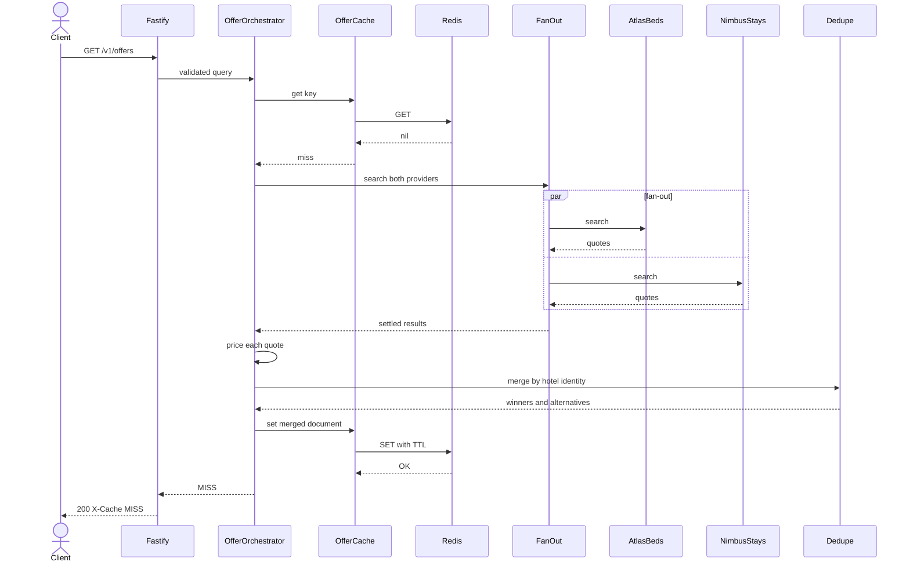
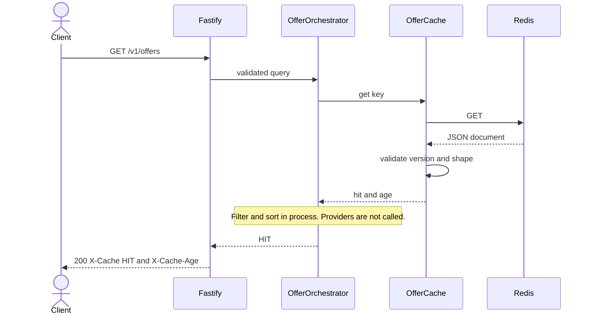
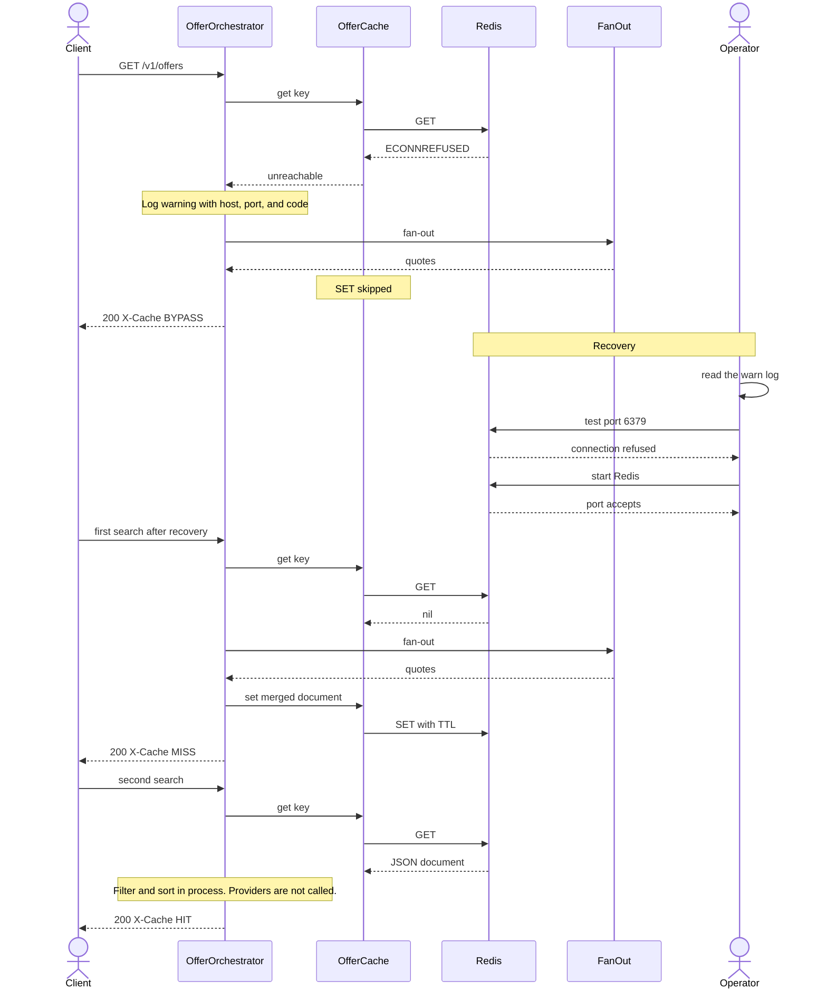
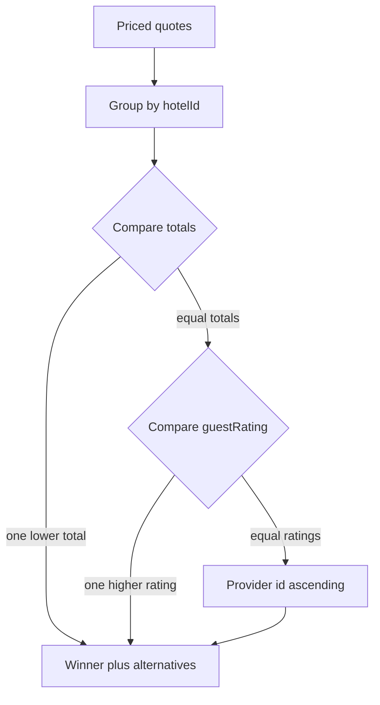

# Offer Desk request flow

`GET /v1/offers` takes one of three cache paths. Filters and sort happen in the process on every path, after a document exists. The sequences below use the default stay when the UTC date is 2026-11-21: Delhi, check-in 2026-11-22, check-out 2026-11-24, two guests. The key is `offers:v1:delhi:2026-11-22:2026-11-24:2:inr`.

`X-Cache` is `HIT`, `MISS`, `BYPASS`, or `COALESCED`. The body copies that onto `meta.cache`.

## Cache miss

Redis has no key. The leader calls both providers, prices the quotes, merges them, stores the document, and returns `MISS`.



Both providers returned, so the reason is `stored` and the TTL is 900 seconds plus a uniform jitter of 0 through 30 seconds. One provider returned and the other failed, so the reason is still `stored` and the TTL is 30 seconds. The stored document is the full merge. `minPrice`, `maxPrice`, and `sort` are applied to the leader's own response after the write, and they are not written into the key.

`X-Offers-Before-Dedupe` and `X-Offers-After-Dedupe` are the merge counts. `X-Providers-Ok` lists the providers that returned, `atlas` then `nimbus`, with no spaces. The failed header is `-` when both returned.

Singleflight sits around this path. The in-process map is updated before the leader awaits Redis. Another request for the same key that arrives during the fan-out waits on the same promise. The leader still reports `MISS`. The waiter reports `COALESCED` and `joined_inflight`, then applies its own filter and sort to the shared document. Send the second request after the first has returned when the observation you want is `HIT`.

## Cache hit

The document is present and valid. Providers are not called.



`X-Cache` is `HIT`. `X-Cache-Reason` is `fresh`. `X-Cache-Age` is the whole seconds since `storedAt`, truncated, and at least 0. `meta.cache` repeats the status and `meta.cacheAgeSeconds` repeats the age. Provider headers and dedupe headers are taken from the document, so a hit still reports a provider that failed at fill time. `meta.cacheTtlSeconds` on a hit is the time left, not the TTL that was written.

A payload that fails validation leaves this path. It is the corrupt refresh in `ARCHITECTURE.md`: fan-out, overwrite, `MISS`, reason `refreshed_corrupt`.

The filter runs on the way out, which is why it can stay off the key. A request with `maxPrice=18000` may return only The Oberoi at ₹17,200 while Redis holds every merged Delhi hotel. The next request, with no `maxPrice`, is a `HIT` on that same key and returns the cards the first response hid. The second request does not call Atlas or Nimbus.

A hit inside a 30-second partial document behaves the same way. The failed provider is not retried until the key expires.

## Redis down

`GET` fails fast. The search fans out anyway, skips `SET`, and returns `BYPASS`.



The warning is one line per failed command. On this path `SET` is skipped, so the request logs the `GET` failure once:

```
cache bypassed because redis is unreachable
```

The fields are `host`, `port`, and `code`. With the default URL and nothing listening, `host` is `127.0.0.1`, `port` is `6379`, and `code` is `ECONNREFUSED` once the socket reports it. Connect and command timeouts are 300ms, and the offline queue is disabled. A dead client is replaced once, then the request calls the providers. It does not wait on Redis's reconnect loop.

The operator loop is the bottom half of the diagram.

1. Read the warning and take the host and port from it. Those are the host and port the process dialed, which inside Compose is the name `redis`, not `127.0.0.1`.
2. Test that port. `ECONNREFUSED` means the TCP connect was rejected. Start Redis.
3. The first search after Redis accepts connections is a normal miss. It writes the key and returns `MISS`.
4. The second search, sent after the first has returned, is `HIT`.

A waiter that shared a bypass flight reports `BYPASS` / `redis_unreachable`, the same as the leader. `COALESCED` is only for a waiter whose leader stored or read a document. Nothing was written either way.

If Redis dies between a successful miss `GET` and the `SET`, the `SET` logs the same warning, nothing is written, and the client still receives the offers with `BYPASS`.

## Dedupe, worked example

Query: `city=delhi`, two nights, two guests. Check-in `2026-11-22`, check-out `2026-11-24`.

Atlas Beds lists `Oberoi New Delhi` at ₹9,250 a night. Nimbus Stays lists `The Oberoi` at ₹8,600 a night. Both quotes are 5 stars. Nimbus carries `guestRating` 9.4. Atlas carries `guestRating` 9.2.

Identity:

| Provider | Listed name | Alias | City | `hotelId` | Base nightly |
| --- | --- | --- | --- | --- | --- |
| atlas | Oberoi New Delhi | The Oberoi | Delhi | `delhi:the-oberoi` | 9250 |
| nimbus | The Oberoi | The Oberoi | Delhi | `delhi:the-oberoi` | 8600 |

Two guests sit inside the base rate, so the charged `nightlyRate` equals the catalog rate. `totalPrice` is that rate times two nights.

| Provider | Nightly charged | Total |
| --- | --- | --- |
| nimbus | 8600 | 17200 |
| atlas | 9250 | 18500 |

The ids match, so the quotes become one card. The lower guest total wins. Nimbus is the winner. Atlas is the alternative. `savingsVsNext` is `18500 - 17200 = 1300`.

The card the client receives:

| Field | Value |
| --- | --- |
| `hotelId` | `delhi:the-oberoi` |
| `name` | The Oberoi |
| `city` | Delhi |
| `stars` | 5 |
| `guestRating` | 9.4 |
| `provider` | `nimbus` |
| `providerName` | Nimbus Stays |
| `nightlyRate` | 8600 |
| `nights` | 2 |
| `guests` | 2 |
| `totalPrice` | 17200 |
| `currency` | INR |
| `commissionPct` | 12 |
| `savingsVsNext` | 1300 |
| `alternatives[0]` | `atlas`, Atlas Beds, `totalPrice` 18500, `guestRating` 9.2, `commissionPct` 10 |

Atlas listed the building as Oberoi New Delhi. That string is not on the alternative object. The shared `hotelId` is the merge. `commissionPct` is stored and is not read by the comparator. Nimbus also has the higher commission on this card, so the commission trap is the Sunder Nagar House case in `ARCHITECTURE.md`, not this one.

The ratings do not decide this card. The totals differ. They are on the quote because a tie uses them.

Winner comparator, within one `hotelId`:



Equal totals fall through to `guestRating`. Equal ratings fall through to provider id, `atlas` before `nimbus`. The rest of the group becomes `alternatives`, already in that order. `savingsVsNext` uses `alternatives[0].totalPrice - totalPrice`.

Three guests show the rounding order. Each guest past two adds 15% of the base nightly rate. The nightly figure is rounded to the rupee, then multiplied by nights.

```
extra = max(0, guests - 2)
nightlyRate = round(baseNightlyRate * (1 + 0.15 * extra))
totalPrice = nightlyRate * nights
```

| Guests | Factor | Nimbus nightly | Nimbus total | Atlas nightly | Atlas total |
| --- | --- | --- | --- | --- | --- |
| 2 | 1.00 | 8600 | 17200 | 9250 | 18500 |
| 3 | 1.15 | 9890 | 19780 | 10638 | 21276 |

`8600 * 1.15` is 9890 exactly. `9250 * 1.15` is 10637.5, which rounds half away from zero to 10638. Times two nights, Atlas is 21276. Multiplying 10637.5 by two nights first and rounding afterwards would yield 21275. The service rounds the nightly rate first, so the Atlas total for three guests and two nights is 21276. Nimbus still wins. `savingsVsNext` is `21276 - 19780 = 1496`.

Both quotes are priced with this rule before the comparator runs. Comparison uses `totalPrice`.
